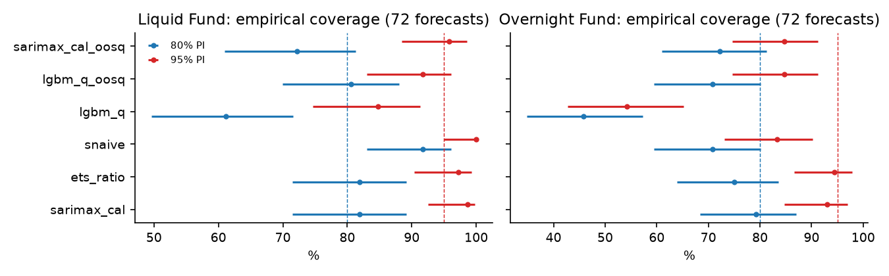
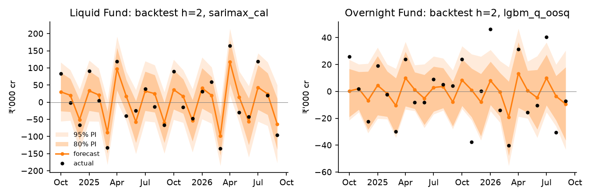
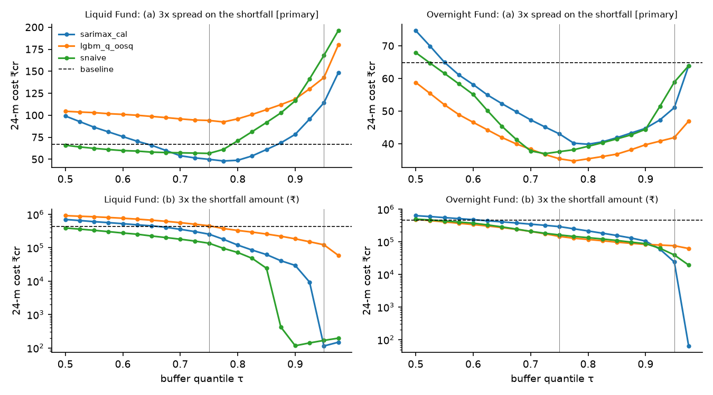
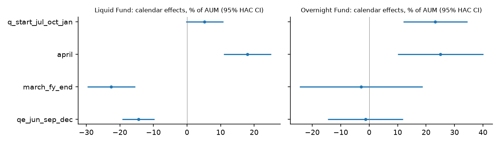
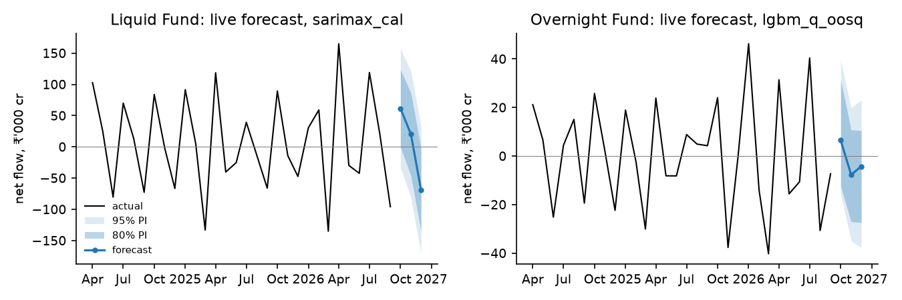

<!-- GENERATED by scripts/build_report.py from reports/report_template.md + outputs/*.csv. Edit the template, not this file. -->
# PS 03: Forecasting Liquid & Overnight net flows and sizing the cash buffer

_All numbers below are produced by `python -m liqfc run` and rendered from `outputs/*.csv` by `scripts/report_tables.py` and `scripts/build_report.py` (this file is generated from `reports/report_template.md`; the numbers in sentences are filled in from the CSVs). Units are ₹ crore; negative net flow = net outflow._

> **Penalty definition (read this first).** The brief prices decision cost as "yield given up on idle cash + a 3× penalty on any redemption shortfall". This report uses **reading (a), primary:** each rupee short costs **3 × the monthly idle-cash spread** (3 × shortfall × s/1200, where s is FBIL 3M T-bill − WACR, floored at 0.10%). **Reading (b)** charges **3 × the shortfall amount itself** (₹3 per ₹1 short). Both are computed everywhere (`outputs/decision_costs.csv`, column `penalty_basis`; §3a; dashboard). **Yes, the conclusion flips.** Under reading (a) q75 is cheaper than q95 in 11 of 12 category × model cases and q95 in 1; under reading (b) q75 is cheaper than q95 in 0 of 12 category × model cases and q95 in 12. The cheaper policy changes in 11 of 12 cases. The forecast-based q75 buffer from `sarimax_cal` beats the naive baseline under **both** readings in both categories (Liquid -26% / -40%; Overnight -34% / -37%). The point estimates favour the forecast buffer, but under reading (a) the Liquid gain is not statistically clear: its 90% bootstrap CI of the 24-month difference [-33.3, +23.0] ₹cr includes 0 (Overnight: 90% bootstrap CI of the 24-month difference [-30.1, -11.3] ₹cr excludes 0). The choice between q75 and q95 depends on the reading.

## 1. Data
* **AMFI** monthly reports (official, `amfiindia.com/spages/am{mon}{yyyy}repo.xls`). There are 102 genuine workbooks. 75 are xlsx content saved under a .xls name and 27 are OLE2 xls, so the parser picks the engine from magic bytes. 42 URLs (Jan-2015 to Mar-2018 and Oct-Dec-2026) returned 404 HTML pages. Those pages were not kept, and the loader rejects any non-workbook and logs it.
  * Apr-2018 to Mar-2019 files use the old sponsor-wise layout, with a single combined Liquid/Money-Market row, so they are excluded. **The panel runs 2019-04 to 2026-09: 90 months × 2 categories.**
  * Validation passes: no duplicates or gaps, sales − redemptions = net within 0.1 cr (max residual ~1e-9), no negative gross flows, AUM-continuity unit checks hold, and the panel matches the auditor's independent extract on all 180 rows.
  * Six 2020 files have no unit text. Their units were confirmed through AUM continuity.
  * One robust outlier is flagged and kept: Overnight 2019-11.
  * AMFI figures are first releases and are treated as provisional.
* **Release dates** come from the "Released on" stamp: the lag after month-end is 8 to 13 days. Where a file has no stamp (2019-05, 2020-01, 2021-12 and 2025-09 to 2026-09) the date is set to month-end + 13 days, the maximum observed lag.
* **Drivers** (`data/raw/MANIFEST.csv` has URL, retrieval time in UTC and IST, sha256 and notes for 330 files):
  * WACR: RBI daily call rates.
  * Net LAF liquidity: RBI Money Market Operations "net liquidity from today's operations", from Jul-2020 onward.
  * FBIL 3M T-bill benchmark: official public archive.
  * Nifty 50 month-end close: NSE official archive files.
  * Daily RBI series up to 17-Sep-2026 come from `dbie.rbihub.in`. This is a **third-party DBIE mirror, not confirmed official**. It matched the official RBI press release of 15-Sep-2026 exactly (test `test_mirror_matches_official_release_sep15`). Days after 17-Sep come from official RBI press releases. 23, 26–28 and 30 Sep 2026 were not found, so September liquidity averages 23 days.
  * DBIE mirror tables that were unusable (policy rates with empty values, T-bill auctions with corrupted decimals, a Nifty table with duplicate months) are listed in the manifest and not used.

## 2. Method
* **Classical models:**
  * `snaive`: y(t−12), with PIs from in-sample seasonal differences.
  * `snaive_ratio`: the same, applied to flow/lagged AUM and rescaled by AUM_T.
  * `ets_ratio`: ETS(A,N,A) on that ratio.
  * `sarimax_cal`: AR(1) on the ratio with calendar dummies (Jun/Sep/Dec advance-tax quarter-ends, March FY-end, April, other quarter starts).
* **ML model:** `lgbm_q`, quantile LightGBM with 9 quantiles and sorted outputs so they cannot cross. It is pooled over both categories and all horizons, fits each horizon directly, and predicts the target y(t+h)/AUM_t.
  * Features: target-month calendar, ratio lags, the same month last year (and the year before), 12-month AUM growth, WACR level and 3-month change, T-bill−WACR spread, net LAF, and Nifty 1-month and 3-month returns.
  * Hyper-parameters were fixed in `config.yaml` beforehand and not tuned.
* **Out-of-sample, horizon-specific PIs** (`*_oosq`): at each origin, the quantiles of that model's own past out-of-sample errors (scaled by AUM) for the same category and horizon, using only targets already released. A model gets these PIs once it has at least 12 such errors.
* **Rolling-origin backtest:** origins run from 2022-03 to 2026-08 and every model is refit at each origin. The headline window is the 24 targets Oct-2024 to Sep-2026 for h = 1, 2 and 3, which gives 72 forecasts per model per category.
* **Nested selection:** each category's model is chosen on pinball loss over Oct-2024 to Sep-2025 only, then reported on Oct-2025 to Sep-2026.
* **No-leakage checks** (tests):
  * Scrambling all data after the origin leaves every model's forecast unchanged.
  * ML features built from data truncated at T equal those built from the full data.
  * A driver whose `available_date` falls after the release date is dropped.
  * Backtest rows always have target > origin and as_of < target release.
  * Removing the truncation in `info_set` makes 6 of these tests fail (checked by deliberately breaking the code).

## 3. Results: accuracy, calibration and decision cost (24 targets × h = 1–3; decision uses h=2)
* **MAPE handling:** MAPE is reported on all points, as the spec requires. Net flows cross zero, so MAPE is dominated by small months: Overnight snaive is 497%, but only 133% once |y| < 2,000 cr is excluded. Read median APE, MASE and pinball alongside it.
* The seasonal-naive figures reproduce the auditor's reference values exactly: Liquid MAPE 137%, median APE 53%, MAE 33,199; Overnight MAPE 497%, median APE 81%, MAE 15,804.
* Coverage is pooled over 72 overlapping forecasts. Because those forecasts are not independent, the Wilson intervals are optimistic.

| Category | Model | MAPE % | MAPE excl. abs(y)<2k cr % | Median APE % | sMAPE % | MAE ₹cr | MASE | Pinball (core) ₹cr | Cov80 [Wilson] | Cov95 [Wilson] | Cost q75 (a) ₹cr (vs base) | Cost q95 (a) ₹cr (vs base) |
|---|---|---|---|---|---|---|---|---|---|---|---|---|
| Liquid Fund | sarimax_cal_oosq | 115 | 76 | 49 | 81 | 31,242 | 0.78 | 6,561 | 72% [61%,81%] | 96% [88%,99%] | 53.3 (-21%) | 85.3 (+27%) |
| Liquid Fund | sarimax_cal | 115 | 76 | 49 | 81 | 31,242 | 0.78 | 6,563 | 82% [72%,89%] | 99% [93%,100%] | 50.0 (-26%) | 114.3 (+70%) |
| Liquid Fund | ets_ratio | 146 | 87 | 50 | 84 | 33,801 | 0.84 | 7,036 | 82% [72%,89%] | 97% [90%,99%] | 66.4 (-1%) | 124.0 (+85%) |
| Liquid Fund | ets_ratio_oosq | 146 | 87 | 50 | 84 | 33,801 | 0.84 | 7,042 | 78% [67%,86%] | 94% [87%,98%] | 69.6 (+4%) | 115.7 (+72%) |
| Liquid Fund | snaive | 137 | 140 | 53 | 83 | 33,199 | 0.83 | 7,267 | 92% [83%,96%] | 100% [95%,100%] | 56.7 (-16%) | 168.0 (+150%) |
| Liquid Fund | snaive_oosq | 137 | 140 | 53 | 83 | 33,199 | 0.83 | 7,297 | 88% [78%,93%] | 100% [95%,100%] | 58.1 (-13%) | 166.7 (+148%) |
| Liquid Fund | snaive_ratio_oosq | 154 | 158 | 49 | 79 | 33,223 | 0.83 | 7,449 | 89% [80%,94%] | 99% [93%,100%] | 76.9 (+15%) | 185.0 (+176%) |
| Liquid Fund | snaive_ratio | 154 | 158 | 49 | 79 | 33,223 | 0.83 | 7,808 | 96% [88%,99%] | 100% [95%,100%] | 78.3 (+17%) | 205.2 (+206%) |
| Liquid Fund | lgbm_q_oosq | 144 | 82 | 70 | 107 | 42,429 | 1.06 | 9,068 | 81% [70%,88%] | 92% [83%,96%] | 94.2 (+40%) | 142.9 (+113%) |
| Liquid Fund | lgbm_q | 144 | 82 | 70 | 107 | 42,429 | 1.06 | 10,307 | 61% [50%,72%] | 85% [75%,91%] | 79.0 (+18%) | 134.4 (+100%) |
| Overnight Fund | sarimax_cal | 133 | 81 | 81 | 128 | 14,047 | 1.02 | 3,172 | 79% [68%,87%] | 93% [85%,97%] | 43.1 (-34%) | 51.1 (-21%) |
| Overnight Fund | sarimax_cal_oosq | 133 | 81 | 81 | 128 | 14,047 | 1.02 | 3,228 | 72% [61%,81%] | 85% [75%,91%] | 40.8 (-37%) | 47.6 (-27%) |
| Overnight Fund | ets_ratio | 207 | 82 | 73 | 113 | 14,736 | 1.07 | 3,304 | 75% [64%,84%] | 94% [87%,98%] | 42.1 (-35%) | 54.6 (-16%) |
| Overnight Fund | ets_ratio_oosq | 207 | 82 | 73 | 113 | 14,736 | 1.07 | 3,384 | 76% [65%,85%] | 85% [75%,91%] | 41.5 (-36%) | 52.8 (-19%) |
| Overnight Fund | snaive_oosq | 497 | 133 | 81 | 119 | 15,804 | 1.15 | 3,412 | 72% [61%,81%] | 92% [83%,96%] | 40.0 (-38%) | 64.1 (-1%) |
| Overnight Fund | snaive_ratio | 493 | 131 | 80 | 116 | 15,557 | 1.13 | 3,413 | 79% [68%,87%] | 92% [83%,96%] | 38.2 (-41%) | 71.0 (+10%) |
| Overnight Fund | lgbm_q_oosq | 184 | 76 | 70 | 115 | 14,816 | 1.08 | 3,423 | 71% [59%,80%] | 85% [75%,91%] | 35.4 (-45%) | 41.9 (-35%) |
| Overnight Fund | snaive | 497 | 133 | 81 | 119 | 15,804 | 1.15 | 3,426 | 71% [59%,80%] | 83% [73%,90%] | 37.6 (-42%) | 58.9 (-9%) |
| Overnight Fund | snaive_ratio_oosq | 493 | 131 | 80 | 116 | 15,557 | 1.13 | 3,444 | 71% [59%,80%] | 86% [76%,92%] | 38.4 (-41%) | 55.9 (-14%) |
| Overnight Fund | lgbm_q | 184 | 76 | 70 | 115 | 14,816 | 1.08 | 4,834 | 46% [35%,57%] | 54% [43%,65%] | 50.9 (-21%) | 48.9 (-25%) |

Baseline (hold last year's same-month net outflow) 24-month cost, h=2 decision: Liquid Fund: ₹67.1 cr (8 shortfall months, mean buffer ₹29,060 cr); Overnight Fund: ₹64.9 cr (10 shortfall months, mean buffer ₹6,190 cr)

Per-horizon detail: reports/tables_by_h.md. Nested selection:

| Category | Model | Pinball select window (Oct24-Sep25) | Pinball eval window (Oct25-Sep26) | MAE eval | Cov80 eval | Cov95 eval | Selected |
|---|---|---|---|---|---|---|---|
| Liquid Fund | ets_ratio_oosq | 7,616 | 6,467 | 30,951 | 81% | 100% |  |
| Liquid Fund | ets_ratio | 7,464 | 6,608 | 30,951 | 86% | 97% |  |
| Liquid Fund | sarimax_cal_oosq | 6,418 | 6,704 | 31,747 | 78% | 92% |  |
| Liquid Fund | sarimax_cal | 6,301 | 6,826 | 31,747 | 83% | 97% | **yes** |
| Liquid Fund | snaive_ratio_oosq | 8,052 | 6,846 | 28,865 | 89% | 100% |  |
| Liquid Fund | snaive_oosq | 7,650 | 6,945 | 30,895 | 89% | 100% |  |
| Liquid Fund | snaive | 7,539 | 6,995 | 30,895 | 92% | 100% |  |
| Liquid Fund | snaive_ratio | 8,343 | 7,274 | 28,865 | 100% | 100% |  |
| Liquid Fund | lgbm_q_oosq | 8,098 | 10,038 | 44,219 | 83% | 83% |  |
| Liquid Fund | lgbm_q | 9,361 | 11,252 | 44,219 | 64% | 86% |  |
| Overnight Fund | snaive_ratio | 3,061 | 3,765 | 17,371 | 75% | 92% |  |
| Overnight Fund | snaive_oosq | 2,931 | 3,893 | 17,445 | 67% | 89% |  |
| Overnight Fund | sarimax_cal | 2,446 | 3,898 | 18,197 | 69% | 89% |  |
| Overnight Fund | snaive_ratio_oosq | 2,935 | 3,953 | 17,371 | 61% | 81% |  |
| Overnight Fund | snaive | 2,846 | 4,006 | 17,445 | 58% | 75% |  |
| Overnight Fund | sarimax_cal_oosq | 2,438 | 4,018 | 18,197 | 61% | 78% |  |
| Overnight Fund | ets_ratio | 2,419 | 4,190 | 19,628 | 67% | 92% |  |
| Overnight Fund | ets_ratio_oosq | 2,552 | 4,217 | 19,628 | 67% | 83% |  |
| Overnight Fund | lgbm_q_oosq | 2,322 | 4,524 | 19,648 | 58% | 78% | **yes** |
| Overnight Fund | lgbm_q | 3,105 | 6,564 | 19,648 | 33% | 44% |  |

**What the results show.**
1. **Accuracy.** `sarimax_cal` is best for both categories on pooled pinball and MAE.
   * Liquid: pinball 6,563 vs 7,267 for snaive (−10%), MASE 0.78.
   * Overnight: pinball 3,172 vs 3,426 (−7%).
   * Its gain over seasonal-naive is modest, and Overnight MASE is about 1.0, so Overnight is essentially unforecastable beyond seasonality.
2. **The ML challenger does not beat the classical models.** Raw `lgbm_q` is the worst model on pinball and MAE for Liquid (MAE 42,429 vs 31,242), and its PIs under-cover: Overnight 80% PI covers 46% [35%, 57%]. The quantile GBM overfits on about 200 pooled training rows. Recalibrating its intervals with past out-of-sample errors (`lgbm_q_oosq`) repairs coverage (Liquid 81%) but not accuracy.
3. **Coverage.** The classical models are roughly calibrated at 80%: `sarimax_cal` gives Liquid 82% and Overnight 79%. snaive over-covers Liquid (92% / 100%), i.e. its intervals are too wide. Overnight 95% intervals tend to under-cover (83–94%).
4. **Nested selection** picks `sarimax_cal` for Liquid. For Overnight it picks `lgbm_q_oosq`, which then ranks 9 of 10 on the evaluation window (pinball 4,524; best was `snaive_ratio` (3,765)). With only 12 selection months the choice is noisy. I report this as it came out and did not re-pick on the test window.

**Decision layer, penalty reading (a)** (h=2, FBIL 3M − WACR spread; 90% moving-block-bootstrap CI of the 24-month total cost difference vs the baseline):

| Category | Model | Policy | Total cost diff vs baseline ₹cr | 90% block-bootstrap CI | Months cheaper (of 24) |
|---|---|---|---|---|---|
| Liquid Fund | sarimax_cal | q75 | -17.1 | [-33.3, +23.0] | 7 |
| Liquid Fund | snaive | q75 | -10.4 | [-26.5, +25.3] | 6 |
| Liquid Fund | ets_ratio | q75 | -0.7 | [-13.5, +28.8] | 7 |
| Liquid Fund | snaive_ratio | q75 | +11.1 | [-2.9, +42.7] | 6 |
| Liquid Fund | lgbm_q | q75 | +11.9 | [-13.4, +64.8] | 8 |
| Liquid Fund | lgbm_q_oosq | q75 | +27.0 | [+1.4, +75.8] | 5 |
| Liquid Fund | sarimax_cal | q95 | +47.2 | [+21.9, +79.0] | 5 |
| Liquid Fund | ets_ratio | q95 | +56.8 | [+26.0, +82.3] | 4 |
| Liquid Fund | lgbm_q | q95 | +67.3 | [+36.1, +132.2] | 4 |
| Liquid Fund | lgbm_q_oosq | q95 | +75.8 | [+36.3, +108.2] | 5 |
| Liquid Fund | snaive | q95 | +100.9 | [+73.3, +140.0] | 3 |
| Liquid Fund | snaive_ratio | q95 | +138.1 | [+95.6, +171.5] | 1 |
| Overnight Fund | lgbm_q_oosq | q75 | -29.4 | [-47.6, -14.5] | 10 |
| Overnight Fund | snaive | q75 | -27.3 | [-42.9, -9.2] | 9 |
| Overnight Fund | snaive_ratio | q75 | -26.7 | [-46.0, -9.6] | 9 |
| Overnight Fund | ets_ratio | q75 | -22.7 | [-31.8, -9.4] | 11 |
| Overnight Fund | sarimax_cal | q75 | -21.8 | [-30.1, -11.3] | 14 |
| Overnight Fund | lgbm_q | q75 | -13.9 | [-22.2, -1.0] | 11 |
| Overnight Fund | lgbm_q_oosq | q95 | -22.9 | [-44.9, -7.4] | 8 |
| Overnight Fund | lgbm_q | q95 | -16.0 | [-30.1, -3.3] | 12 |
| Overnight Fund | sarimax_cal | q95 | -13.8 | [-37.1, +4.0] | 8 |
| Overnight Fund | ets_ratio | q95 | -10.3 | [-32.8, +9.2] | 8 |
| Overnight Fund | snaive | q95 | -6.0 | [-28.2, +16.1] | 8 |
| Overnight Fund | snaive_ratio | q95 | +6.2 | [-16.8, +23.2] | 7 |

* **Under reading (a), the spec's 95th-percentile buffer is too conservative for Liquid.** Across the 10 forecasters it costs +27% to +206% relative to the naive baseline, and the 90% CI excludes 0 on the costly side for 9 of 10. For Overnight, q95 changes cost by -35% to +10% (9 of 10 cheaper than baseline). Under reading (b) this conclusion reverses (§3a). Under this cost function the cost-minimising quantile is the newsvendor critical ratio 3/(3+1) = **0.75**. That value is set in `config.yaml` and was not tuned on the test window.
* **The q75 policy beats the baseline for Overnight.** With `sarimax_cal` the cost changes by -34%. Across the 10 forecasters the 24-month cost changes by -45% to -21% (10 of 10 cheaper than baseline; 90% CI excludes 0 on the cheap side for 10 of 10).
* **For Liquid, q75 + `sarimax_cal` changes cost by -26%** (backtest q75, penalty reading (a): ₹17.1 cr cheaper than baseline over 24 m (90% CI includes 0)).
* The sign of these results holds when the spread is a constant 0.50% (`reports/tables_decision_sensitivity.md`). The h=1 rows there are an oracle-timing check only: the M−1 release arrives around the 10th of M, after the day-1 decision, so h=1 is not feasible live.
* **Costs are small in ₹** (tens of crore over 24 months) because the T-bill − WACR spread sat at the 0.10% floor in 18 of 24 months; WACR traded above the 3M T-bill. Rankings are therefore driven largely by shortfall versus idle amounts, not by the spread level.
* **Net, not gross, category outflow** is used. A single fund should scale the buffer by its share of category AUM.

## 3a. Penalty reading: both cost tables and whether the conclusion flips
**Reading (a), primary:** shortfall cost = 3 × shortfall × s/1200, so idle and shortfall are priced in the same unit (₹ of carry per month) and the penalty is three times the idle rate. **Reading (b):** shortfall cost = 3 × shortfall (₹). Idle cost is idle × s/1200 under both. h=2, realised spread, 24 months Oct-2024 to Sep-2026; full tables for six models in `reports/tables_penalty.md`.

| Category | Model | Policy | Breach months | Mean buffer ₹cr | (a) cost ₹cr | (a) vs baseline | (b) cost ₹cr | (b) vs baseline |
|---|---|---|---|---|---|---|---|---|
| Liquid Fund | baseline | smly_baseline | 8 | 29,060 | 67.1 | +0% | 427,724 | +0% |
| Liquid Fund | sarimax_cal | q75 | 6 | 35,399 | 50.0 | -26% | 255,233 | -40% |
| Liquid Fund | sarimax_cal | q95 | 0 | 74,057 | 114.3 | +70% | 114 | -100% |
| Liquid Fund | lgbm_q_oosq | q75 | 7 | 40,027 | 94.2 | +40% | 456,274 | +7% |
| Liquid Fund | lgbm_q_oosq | q95 | 2 | 75,892 | 142.9 | +113% | 122,700 | -71% |
| Liquid Fund | snaive | q75 | 4 | 43,702 | 56.7 | -16% | 136,712 | -68% |
| Liquid Fund | snaive | q95 | 0 | 92,426 | 168.0 | +150% | 168 | -100% |
| Liquid Fund | ets_ratio | q75 | 7 | 37,800 | 66.4 | -1% | 289,238 | -32% |
| Liquid Fund | ets_ratio | q95 | 1 | 73,490 | 124.0 | +85% | 19,604 | -95% |
| Overnight Fund | baseline | smly_baseline | 10 | 6,190 | 64.9 | +0% | 467,918 | +0% |
| Overnight Fund | sarimax_cal | q75 | 7 | 9,395 | 43.1 | -34% | 292,451 | -37% |
| Overnight Fund | sarimax_cal | q95 | 3 | 27,588 | 51.1 | -21% | 24,119 | -95% |
| Overnight Fund | lgbm_q_oosq | q75 | 7 | 14,948 | 35.4 | -45% | 146,666 | -69% |
| Overnight Fund | lgbm_q_oosq | q95 | 2 | 21,788 | 41.9 | -35% | 75,850 | -84% |
| Overnight Fund | snaive | q75 | 4 | 16,809 | 37.6 | -42% | 162,508 | -65% |
| Overnight Fund | snaive | q95 | 2 | 31,578 | 58.9 | -9% | 39,496 | -92% |
| Overnight Fund | ets_ratio | q75 | 6 | 11,104 | 42.1 | -35% | 279,762 | -40% |
| Overnight Fund | ets_ratio | q95 | 2 | 29,060 | 54.6 | -16% | 40,461 | -91% |

**Does q75 vs q95 flip?**

| Category | Model | (a) q75 | (a) q95 | (a) cheaper | (b) q75 | (b) q95 | (b) cheaper | Flips |
|---|---|---|---|---|---|---|---|---|
| Liquid Fund | ets_ratio | 66.4 | 124.0 | q75 | 289,238 | 19,604 | q95 | **yes** |
| Liquid Fund | lgbm_q | 79.0 | 134.4 | q75 | 536,914 | 149,613 | q95 | **yes** |
| Liquid Fund | lgbm_q_oosq | 94.2 | 142.9 | q75 | 456,274 | 122,700 | q95 | **yes** |
| Liquid Fund | sarimax_cal | 50.0 | 114.3 | q75 | 255,233 | 114 | q95 | **yes** |
| Liquid Fund | sarimax_cal_oosq | 53.3 | 85.3 | q75 | 284,587 | 38,668 | q95 | **yes** |
| Liquid Fund | snaive | 56.7 | 168.0 | q75 | 136,712 | 168 | q95 | **yes** |
| Overnight Fund | ets_ratio | 42.1 | 54.6 | q75 | 279,762 | 40,461 | q95 | **yes** |
| Overnight Fund | lgbm_q | 50.9 | 48.9 | q95 | 386,947 | 231,981 | q95 | no |
| Overnight Fund | lgbm_q_oosq | 35.4 | 41.9 | q75 | 146,666 | 75,850 | q95 | **yes** |
| Overnight Fund | sarimax_cal | 43.1 | 51.1 | q75 | 292,451 | 24,119 | q95 | **yes** |
| Overnight Fund | sarimax_cal_oosq | 40.8 | 47.6 | q75 | 171,635 | 56,810 | q95 | **yes** |
| Overnight Fund | snaive | 37.6 | 58.9 | q75 | 162,508 | 39,496 | q95 | **yes** |

**Yes, the conclusion flips.** Under reading (a) q75 is cheaper than q95 in 11 of 12 category × model cases and q95 in 1; under reading (b) q75 is cheaper than q95 in 0 of 12 category × model cases and q95 in 12. The cheaper policy changes in 11 of 12 cases.

**Why (a) is primary.**
1. The brief puts the penalty next to "yield given up on idle cash", which is a rate. The natural reading is a 3× rate on the rupees that are short, so both terms are in the same unit. That gives a well-posed newsvendor problem whose optimal buffer is the 3/(3+1) = 0.75 quantile; `policy_quantiles` in `config.yaml` sets it, and it was not tuned on the test window.
2. Under (b) a rupee short costs ₹3, while a rupee idle costs s/1200 ≈ ₹0.00008 a month at the 0.10% floor, a ratio of about 36,000:1. The optimal quantile is then about 0.99997. Any buffer below the largest plausible outflow is dominated, the spread data play no role, and the stored 2.5–97.5% quantiles cannot even reach the optimum. A 300% charge on principal is also not what a shortfall costs a liquid fund, which can meet redemptions by selling T-bills/CPs or by short-term borrowing (SEBI (Mutual Funds) Regulations 1996, Reg. 44(2), allows borrowing up to 20% of net assets for up to 6 months for redemptions).

**What to do with it.** If the judges or the fund intend (b), use q95: for November 2026 that is the "Buffer q95" column in §5. Under (a), q75 is the cost-minimising rule. The q75 buffer from `sarimax_cal` beats the baseline under both readings.

## 4. Drivers

* **In-sample HAC regression** (`outputs/driver_regression.csv`, flow as % of prior AUM):
  * Liquid: Jun/Sep/Dec advance-tax quarter-ends −14.5 pp, March FY-end −22.6 pp, April +18.0 pp (all p < 0.001), R² = 0.63 with the calendar alone.
  * Adding contemporaneous WACR, spread, net LAF and Nifty raises Liquid R² only to 0.63–0.65.
  * Overnight: April (+25 pp) and quarter starts (+23 pp) matter. WACR (−3.7 pp per 1 pp, p = 0.01) and net LAF (+3.1 pp per ₹1 lakh cr injection, p = 0.02) are significant contemporaneously, R² = 0.40.
* **Out-of-sample** (LGBM feature-group ablation, `reports/tables_ablation.md`): removing the rates, liquidity or equity features does **not** worsen the forecasts. The calendar-only LGBM has the *lowest* pinball for both categories, so market drivers measured at the origin add no forecasting value beyond calendar effects and target lags at h = 1–3.
* **Regime-break robustness (auditor item 6):** WACR (RBI) is used, not FBIL MIBOR, so the 4-Aug-2025 MIBOR methodology change does not enter the features directly.
  * Break dummies for the SDF floor (8-Apr-2022) and post-Aug-2025 were added to the regression. Calendar coefficients are stable to within 1–3 pp.
  * Post-Aug-2025 is +5.1 pp for Liquid (p = 0.03), which is a level shift rather than a rate effect.

## 5. Live forecast: origin Sep-2026 (as-of 13-Oct-2026), next release = Oct-2026 data (~10-Nov-2026)

| Category | Model | Month | h | Point ₹cr | 80% PI | 95% PI | Buffer q75 | Buffer q95 | Baseline buffer |
|---|---|---|---|---|---|---|---|---|---|
| Liquid Fund | sarimax_cal | 2026-10 | 1 | 61,681 | [-361, 123,722] | [-33,203, 156,565] | 0 | 17,948 | 0 |
| Liquid Fund | sarimax_cal | 2026-11 | 2 | 20,193 | [-46,099, 86,486] | [-81,192, 121,579] | 14,697 | 64,892 | 14,051 |
| Liquid Fund | sarimax_cal | 2026-12 | 3 | -68,770 | [-135,644, -1,897] | [-171,044, 33,503] | 103,966 | 154,601 | 47,308 |
| Overnight Fund | lgbm_q_oosq | 2026-10 | 1 | 6,510 | [-12,496, 31,306] | [-15,434, 39,628] | 5,110 | 13,037 | 0 |
| Overnight Fund | lgbm_q_oosq | 2026-11 | 2 | -7,668 | [-26,991, 10,767] | [-34,974, 19,881] | 21,627 | 29,972 | 37,625 |
| Overnight Fund | lgbm_q_oosq | 2026-12 | 3 | -4,250 | [-27,322, 10,526] | [-37,705, 23,012] | 17,450 | 32,132 | 0 |

All models' live forecasts: `reports/tables_live.md`.

**Recommended buffer for November 2026** (decision on 1-Nov using the h=2 forecast, q75 policy under penalty reading (a); q95 if reading (b) applies):
* **Liquid:** ₹14,697 cr from `sarimax_cal`. The q95 buffer is ₹64,892 cr; the baseline is ₹14,051 cr.
* **Overnight:** ₹21,627 cr from `lgbm_q_oosq`, the nested-selection pick. The q95 buffer is ₹29,972 cr; `sarimax_cal` would give ₹14,745 cr; the baseline is ₹37,625 cr.

**October 2026 point forecast (one figure per category).** Rule, stated in `config.yaml` (`submission: rule: nested_selection, horizon: 1`) on 29-Oct-2026, before AMFI publishes October data (~10-Nov): each category's figure is the h=1 forecast of the model chosen by nested selection, the same model that sets the buffer.

* **Submitted October 2026 forecast, Liquid Fund:** +61,681 cr (`sarimax_cal`, h=1; 80% PI -361 to 123,722; 95% PI -33,203 to 156,565)
* **Submitted October 2026 forecast, Overnight Fund:** +6,510 cr (`lgbm_q_oosq`, h=1; 80% PI -12,496 to 31,306; 95% PI -15,434 to 39,628)

**Why `lgbm_q_oosq` and not `sarimax_cal` for Overnight.** Nested selection picked `lgbm_q_oosq` on Oct-2024 to Sep-2025. On the later evaluation window it ranks 9 of 10 and `sarimax_cal` ranks 3 of 10. Switching to `sarimax_cal` because it did better on the evaluation window would mean choosing on the window that is meant to stay untouched, which is what nested selection exists to prevent. v0.2 quoted `sarimax_cal` for both categories without a stated rule; that is withdrawn. For reference only, `sarimax_cal` gives +18,003 cr for Overnight October (80% PI -4,490 to 40,496).

December, an advance-tax month, is expected to see a large Liquid outflow: -68,770 cr, with a q75 buffer of ₹103,966 cr.

## 6. Data gaps and risks
* AMFI data are first releases, and 16 release dates are imputed (month-end + 13 d).
* The daily RBI series before 17-Sep-2026 come from a third-party DBIE mirror, verified on one day. 5 days are missing in Sep-2026. Net LAF is unavailable before Jul-2020 (LightGBM treats it as missing).
* The evaluation covers only 24 targets; coverage CIs are wide and the forecasts overlap.
* Nested selection on 12 months is unstable (see Overnight).
* The cost function uses an ex-post realised monthly spread that is floor-dominated.
* Category-level net flow is not a single fund's gross redemptions.
* The MIBOR/SDF breaks are tested only in-sample.

## 7. Auditor findings
| # | Finding | Verified? | Fix | Regression test | Effect |
|---|---|---|---|---|---|
| 1 | Apr-18 to Mar-19 files have only a combined Liquid/MM row | Yes: old sponsor-wise layout | Panel starts 2019-04 (`config.data.panel_start`); the parser marks that layout and returns no rows | `test_pre_2019_files_yield_no_category_rows`, `test_panel_starts_2019_04_with_90_months_each` | 90×2 panel, no category mixing |
| 2 | 42 .xls files are 404 HTML | Yes (download log) | Files deleted; loader raises `NotAWorkbook` on non-workbooks and logs `REJECTED` | `test_html_404_rejected_and_logged` | 102 real files, 0 rejected now on disk |
| 3 | xlsx named .xls; identity check | Yes: 75 ZIP, 27 OLE2 | Engine chosen by magic bytes; hard assert that sales−red−net is within 0.1 | `test_engine_from_magic_bytes_not_extension`, `test_flow_identity_within_tolerance`, `test_matches_independent_auditor_extract` | Max residual ~1e-9; all 180 rows match the auditor |
| 4 | Release lag 6–13 d | Yes: observed 8–13 d | Origin as_of = release stamp or month-end+13; drivers need `available_date` ≤ as_of; OOS-PI only uses released targets | `test_info_set_*`, `test_driver_not_available_by_release_is_dropped`, `test_forecast_invariant_to_future_data[*]`, `test_ml_features_equal_under_truncation`, `test_backtest_rows_are_out_of_sample`, `test_oos_calibration_only_uses_released_errors`, `test_release_dates_after_month_end` | Backtest is leakage-free by construction; mutation check confirms the tests bite |
| 5 | Report MAE, sMAPE/MASE, median APE | Agreed | `metrics.summarize` adds median APE, sMAPE, WAPE, MAE, RMSE, MASE, scaled pinball, MAPE excluding small months, and Wilson CIs | `test_point_metrics`, `test_coverage_and_wilson`, `test_pinball_sign_and_values` | snaive reproduces the auditor's numbers exactly |
| 6 | MIBOR methodology break 4-Aug-2025 | Yes, but MIBOR is not used (WACR is) | Break dummies (post-Aug-2025, post-SDF Apr-2022) in the driver regression; LGBM rate-feature ablation | (driver regression output) | Calendar effects stable; rates add no OOS value |

Other auditor points:
* No tuning on the test window: hyper-parameters are fixed and selection is nested.
* Horizon-specific out-of-sample PIs: the `_oosq` variants.
* Wilson CIs on coverage: added.
* Provisional-data note: added.
* The DBIE mirror is flagged as third-party.
* SDF break: dummy added.
* Dashboard numbers trace to CSVs: each block names its source file.
* The baseline uses actual(t−12): `test_policy_and_smly_baseline_use_actual_t_minus_12`.

## 8. Next steps
1. Score the October 2026 figures in §5 when AMFI publishes it (~10-Nov), and extend the evaluation with gross redemptions (a fund-level buffer needs gross, not net, flows).
2. Use a longer selection window (or forecast combination of `sarimax_cal` + `snaive_ratio`) in place of 12-month nested selection, which proved unstable for Overnight. Also add day-of-month intramonth timing of advance-tax outflows (around the 15th) for intra-month buffers.
3. Replace the third-party DBIE mirror with direct RBI DBIE downloads, and fill the 5 missing September days from RBI weekly statistical supplements.

## Local application
Everything above can be reproduced with `python -m liqfc run`. The interactive local dashboard (`python -m liqfc app`, http://127.0.0.1:8501) reads only `outputs/`. Its τ, horizon, spread and penalty controls recompute the decision costs from the backtest quantiles, actual flows and realised spreads. A sidebar switch selects penalty reading (a) or (b), and the Decision-cost tab shows both readings side by side. At τ = 0.75/0.95 with the default settings it reproduces `outputs/decision_costs.csv` exactly under both readings (tests/test_app.py). `python -m liqfc refresh` pulls new months from AMFI, NSE, FBIL and RBI. See README.
